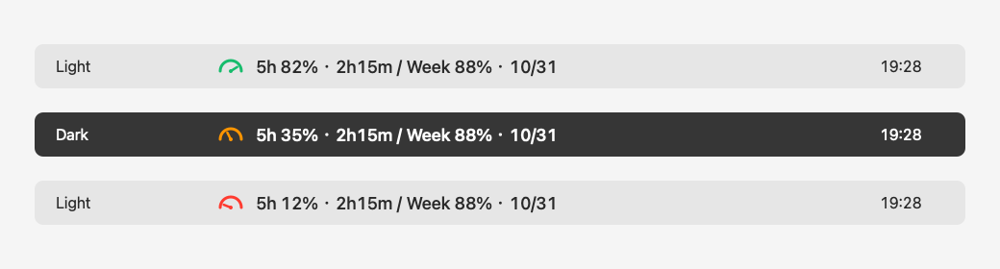

# CodexBar

[Website](https://dragonwong.github.io/codexbar/)

English | [简体中文](README.zh-CN.md)

A minimal, lightweight macOS menu bar app that shows your remaining Codex quota and reset times at a glance.



*Illustration with sample data, showing light/dark appearances and three quota states. This is not a desktop screenshot.*

- A colorful gauge with a needle that tracks your **remaining 5-hour quota**.
- Green above 50%, orange from 20–50%, red below 20%, and gray when data is unavailable.
- Both 5-hour and weekly remaining quotas, with a reset countdown or date.
- Fetches quota every 60 seconds, updates the local countdown every 15 seconds, and refreshes after your Mac wakes.
- Left-click to refresh or quit. Right-click has no action.
- English and Simplified Chinese, selected automatically from your macOS language preferences; other languages fall back to English.
- Native Swift / AppKit, with no third-party runtime libraries or Python dependency.

## Download and run

Download `CodexBar-0.1.1-universal.zip` from [Releases](https://github.com/dragonwong/codexbar/releases), extract it, drag `CodexBar.app` into Applications, and open it. Supports **macOS 13+, Apple Silicon and Intel**.

Install Codex first and sign in with ChatGPT under the same user environment. CodexBar looks for the CLI bundled with Codex.app or ChatGPT.app, as well as `codex` in common locations. If you have not signed in yet, run `codex login` in Terminal.

The app lives in the menu bar and has no Dock icon. The first fetch may take several dozen seconds. If the menu bar is full, try closing other menu bar apps. Launch at login is not currently included.

### First launch

Release builds are ad-hoc signed, **not signed with an Apple Developer ID or notarized by Apple**. macOS may block a downloaded build, so opening it with a double-click is not guaranteed on every Mac. If you trust the source, try opening it once, then go to **System Settings → Privacy & Security → Open Anyway**. You do not need to disable system-wide security protections. Alternatively, build from source.

To verify a download, run this in the directory containing the ZIP and `.sha256` files:

```sh
shasum -a 256 -c CodexBar-0.1.1-universal.zip.sha256
```

To change the language for CodexBar only, use **System Settings → General → Language & Region → Applications**, add CodexBar, and choose English or Simplified Chinese. Restart the app after changing its language.

## Build from source

Install Xcode Command Line Tools:

```sh
xcode-select --install
```

Then:

```sh
git clone https://github.com/dragonwong/codexbar.git
cd codexbar
bash scripts/build.sh
open dist/CodexBar.app
```

This produces `dist/CodexBar.app` with both arm64 and x86_64 binaries. Running the app does not require build tools or Python. Building requires a Swift toolchain and an SDK that supports macOS 13+.

To create a ZIP and SHA-256 checksum:

```sh
bash scripts/package.sh
```

Build outputs go into the local `dist/` directory. Only source files belong in Git; downloadable builds are distributed through GitHub Releases.

## How it works

| File | Purpose |
| --- | --- |
| `Sources/main.swift` | Menu bar UI, gauge, colors, countdowns, and refresh intervals |
| `Sources/Localization.swift` | Language selection and string lookup |
| `Resources/*.lproj/Localizable.strings` | English and Simplified Chinese translations |
| `Sources/UsageReader.swift` | Reads Codex quota over stdio JSON-RPC |
| `scripts/build.sh` | Builds and ad-hoc signs the universal app |
| `scripts/package.sh` | Creates the ZIP and checksum |
| `tests/test_reader.py` | Tests the protocol with a mock Codex server; no account required |
| `.github/workflows/build.yml` | CI builds, tests, and tag-based releases |

Data comes from the official App Server's `account/rateLimits/read` method. CodexBar prefers `rateLimitsByLimitId.codex` and falls back to `rateLimits`. Remaining quota is `100 - usedPercent`. It identifies the 5-hour and weekly windows using `windowDurationMins` values of 300 and 10080. Missing values appear as `--`; quota is never guessed.

The protocol and available data may vary with Codex versions and account plans. This project is not an official OpenAI product.

[Official protocol documentation](https://learn.chatgpt.com/docs/app-server)

### Privacy and troubleshooting

- Only queries quota. Does not read conversations, submit model tasks, or monitor unread messages.
- Does not directly read, log, or upload login credentials. The Codex subprocess handles its own authentication and network requests.
- Has no telemetry service and does not send quota information to the project author.
- On fetch failure, keeps the last successful values and shows a gray gauge with `↻`. Hover to see the error.
- When a reset time has passed, displays “Updating” (or “待更新” in Chinese) until fresh quota data arrives.
- Set `CODEX_BINARY` to use a custom Codex executable. GUI apps may not inherit your terminal environment. Authentication depends on the subprocess's user environment and `CODEX_HOME`. API-key authentication is not equivalent to ChatGPT subscription quota.

For diagnostics, run the reader directly. It outputs only quota data or an error:

```sh
dist/CodexBar.app/Contents/MacOS/UsageReader
```

## Testing and contributing

Issues and pull requests for new features and compatibility improvements are welcome. Before submitting changes:

```sh
bash scripts/package.sh
python3 -m unittest discover -s tests -v
```

Tests require Python 3 for development only. When reporting an issue, include your macOS version, chip architecture, Codex version, and error message. Do not include tokens, authentication files, or private conversations.

To release a new version, update the version strings in `scripts/build.sh` and the reader, update the README download examples in both languages, and push a matching `vVERSION` tag. GitHub Actions will build, test, and publish the release. Make sure Actions is enabled before the first public release.

## License

[MIT](LICENSE) © 2026 dragonwong
