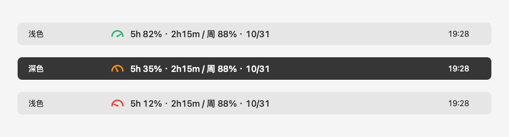

# CodexBar

[English](README.md) | 简体中文

一个极简、轻量的 macOS 菜单栏工具，直接显示 Codex 剩余额度和重置时间。



*界面示意图，使用示例数据，展示浅色 / 深色外观及三种额度状态；并非桌面实拍。*

- 彩色仪表盘，指针随 **5 小时剩余额度**转动。
- 剩余 >50% 绿色、20–50% 橙色、<20% 红色；数据不可用时灰色。
- 同时显示 5 小时与每周剩余额度，以及重置倒计时 / 日期。
- 每 60 秒读取额度，每 15 秒刷新本地倒计时，Mac 唤醒后自动刷新。
- 左键不展开重复面板；右键可立即刷新或退出。
- 支持英文与简体中文，自动跟随 macOS 语言偏好，其他语言回退为英文。
- 原生 Swift / AppKit，无第三方运行库，不依赖 Python。

## 下载安装

在 [Releases](https://github.com/dragonwong/codexbar/releases) 下载 `CodexBar-0.1.0-universal.zip`，解压后将 `CodexBar.app` 拖入“应用程序”，双击运行。支持 **macOS 13+，Apple Silicon 和 Intel**。

需要先安装 Codex，并在同一用户环境通过 ChatGPT 登录。工具会查找 Codex.app、ChatGPT.app 内置 CLI 及常见位置的 `codex`。如果尚未登录，在终端运行 `codex login`。

应用只有菜单栏图标，没有 Dock 图标。首次读取可能需要数十秒；菜单栏空间不足时，尝试关闭其他菜单栏工具。当前没有自动开机启动。

### 首次打开提示

发布包使用临时签名（ad-hoc），**未使用 Apple Developer ID 签名或 Apple 公证**。下载后 macOS 可能拦截，无法保证每台 Mac 都直接双击打开。确认来源可信后，可先尝试打开一次，再到“系统设置 → 隐私与安全性”选择“仍要打开”。不需要关闭系统整体安全保护；也可以自行从源码构建。

校验下载文件：在 ZIP 和 `.sha256` 所在目录运行：

```sh
shasum -a 256 -c CodexBar-0.1.0-universal.zip.sha256
```

如需只修改 CodexBar 的语言，可到“系统设置 → 通用 → 语言与地区 → 应用程序”添加 CodexBar，选择英文或简体中文，修改后重新启动 App。

## 自己编译

安装 Xcode Command Line Tools：

```sh
xcode-select --install
```

然后：

```sh
git clone https://github.com/dragonwong/codexbar.git
cd codexbar
bash scripts/build.sh
open dist/CodexBar.app
```

生成 `dist/CodexBar.app`，同时包含 arm64 与 x86_64。只运行 App 不需要编译工具或 Python。编译需要支持 macOS 13+ 的 SDK 与 Swift 工具链。

打包下载文件（ZIP 和 SHA-256）：

```sh
bash scripts/package.sh
```

编译产物在本地 `dist/`；Git 只保存源码，下载包通过 GitHub Releases 分发。

## 实现与扩展

| 文件 | 用途 |
| --- | --- |
| `Sources/main.swift` | 菜单栏、仪表盘、颜色、倒计时和刷新周期 |
| `Sources/Localization.swift` | 语言选择及文案读取 |
| `Resources/*.lproj/Localizable.strings` | 英文、简体中文翻译 |
| `Sources/UsageReader.swift` | 通过 stdio JSON-RPC 读取 Codex 额度 |
| `scripts/build.sh` | 编译 Universal App，并临时签名 |
| `scripts/package.sh` | 生成 ZIP 和校验文件 |
| `tests/test_reader.py` | 使用模拟 Codex 服务测试协议，不需要账号 |
| `.github/workflows/build.yml` | CI 构建、测试及标签发布 |

数据来自官方 App Server 的 `account/rateLimits/read`，优先读取 `rateLimitsByLimitId.codex`，兼容 `rateLimits`。剩余额度 = `100 - usedPercent`，按 `windowDurationMins` 识别 300 分钟 / 10080 分钟窗口。未返回的值显示 `--`，不会猜测额度。

接口和账号返回可能随 Codex 版本、套餐而变化；本项目不是 OpenAI 官方产品。

[官方协议文档](https://learn.chatgpt.com/docs/app-server)

### 隐私与故障处理

- 只查询额度，不读取对话、不发送模型任务、不做未读监控。
- 不自行读取、记录或上传登录凭据；Codex 子进程负责自己的认证和网络访问。
- 本项目没有遥测服务，也不会把额度发送给项目作者。
- 查询失败保留上次成功数据，用灰色仪表盘和 `↻` 标记，悬停查看错误。
- 重置时间已到显示“待更新”，等待下一次真实额度返回。
- 自定义 Codex 路径可通过 `CODEX_BINARY` 指定；GUI 不一定继承终端环境。登录态取决于 Codex 子进程使用的用户环境及 `CODEX_HOME`，API Key 登录不等同于 ChatGPT 订阅额度。

诊断（只输出额度或错误）：

```sh
dist/CodexBar.app/Contents/macOS/UsageReader
```

## 测试与贡献

欢迎提 Issue 或 Pull Request，添加功能或改进兼容性。提交前：

```sh
bash scripts/package.sh
python3 -m unittest discover -s tests -v
```

测试需要 Python 3，仅用于开发。报告问题请包含 macOS 版本、芯片类型、Codex 版本和错误提示，勿提交 Token、认证文件或私人对话。

发布新版本时，更新 `scripts/build.sh` 和读取器中的版本号，以及 README 的下载示例，然后推送对应的 `v版本号` 标签；GitHub Actions 会构建、测试并生成 Release。首次公开发布前，请检查仓库 Actions 已启用。

## License

[MIT](LICENSE) © 2026 dragonwong
